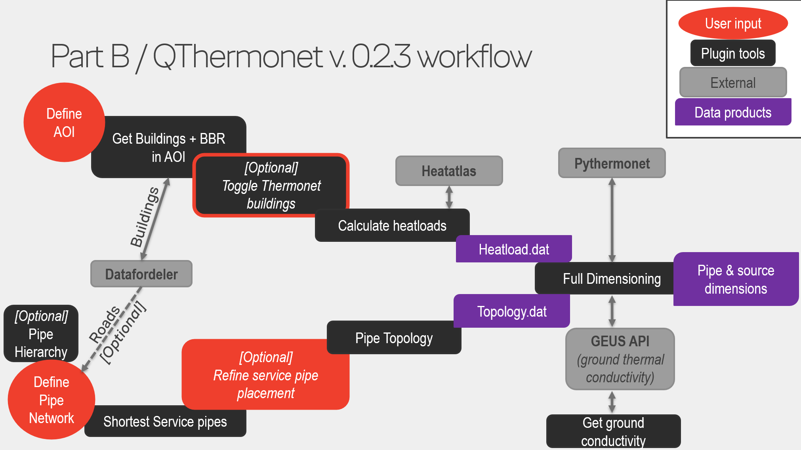

# QThermonet
This plugin enables dimensioning of thermonets in QGIS using pythermonet.

## Version
v0.2.3 is the final version of the plugin for QGIS 3. Future versions of the plugin require QGIS 4.

## About
This plugin serves as a user interface for the pythermonet 'Thermonet Dimensioning Tool' that dimensions 
the diameters of gridpipes in a thermonet as well as the length of Borehole Heat Exchangers (BHE's) or 
Horizontal Heat Exchangers (HHE's) supplying the grid.  
https://github.com/BYKVAD/pythermonet/tree/legacy

## Dependencies
The plugin requires the **legacy** version of pythermonet, installed into the Python environment of QGIS 3:  
https://github.com/BYKVAD/pythermonet/tree/legacy

Newer versions of pythermonet (the `main` branch) have a different interface and do not work with this plugin.

To install it:
1. Download the legacy version: open the link above, click **Code → Download ZIP**, and unzip it.
2. Close QGIS.
3. In the unzipped folder, right-click `install_in_qgis3.bat` and choose **Run as administrator**.
4. Wait for the message `Installation completed`, then start QGIS.

The script finds QGIS 3 in `C:\Program Files` or `C:\OSGeo4W`. The packages QGIS already ships (such as numpy, pandas and scipy) are kept at their current versions; only missing packages are added.

Further installation guidelines are provided in QThermonet_tutorial_1.pdf

## Getting started
Guidlines for installation, description of the individual tools in the plugin, and a small test example is provided in the [`Tutorial1/`](./Tutorial1/) folder.

## Troubleshooting
**Output layers have no coordinate system, or appear in the wrong place on the map.**  
This can happen if PostGIS (installed with PostgreSQL) is installed on the same PC. The PostGIS installer sets a Windows-wide `PROJ_LIB` variable that points QGIS to an older coordinate system database. To fix it inside QGIS only (PostGIS is not affected):
1. In QGIS, open **Settings → Options → System → Environment**.
2. Check **Use custom variables**, and add a row: Apply = `Overwrite`, Variable = `PROJ_LIB`, Value = the `share\proj` folder of your QGIS installation, e.g. `C:\Program Files\QGIS 3.44.15\share\proj`.
3. Restart QGIS.

You can check it in the QGIS Python console with `import os; print(os.environ.get("PROJ_LIB"))`, which should print the QGIS path.

## Disclaimer
The authors take no responsibility for the accuracy of results produced using this tool.  
The plugin has been tested on a Windows 11 OS using QGIS 3.44.15 and has not yet been tested with other setups.  
The current plugin is primarily designed to handle thermonet and heatload calculations in Denmark, future versions are expected to expand functionality to other geographical areas.

## Plugin Workflow

